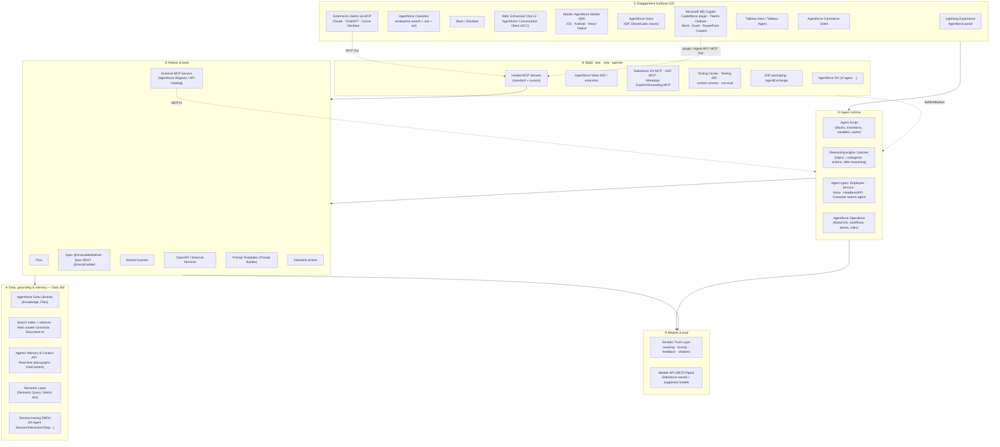
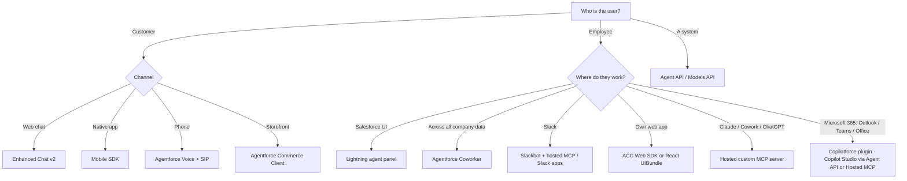
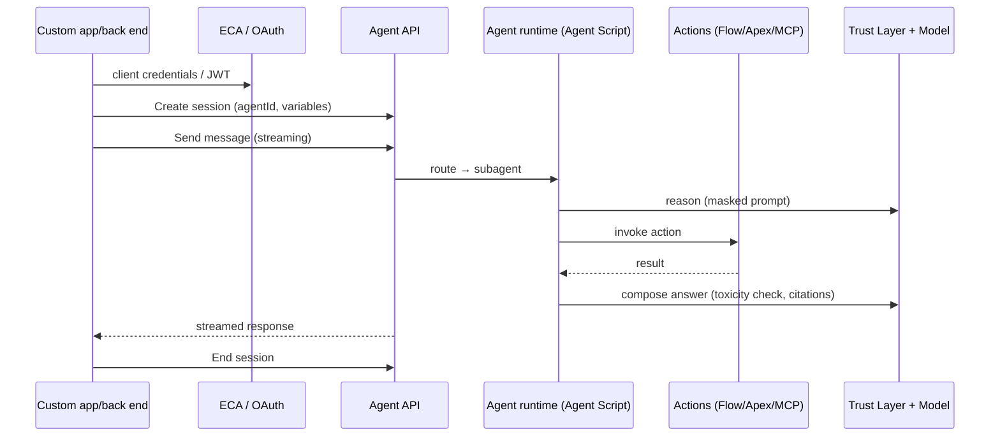
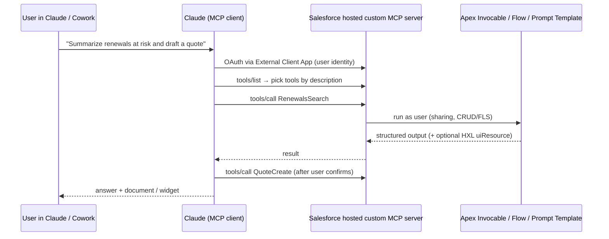

# Agentforce 360 — Complete Architecture Guide

**Products · platforms · UI surfaces · actions · frameworks · tools · scenarios · side-by-side comparisons**

> Built from this repository's catalog of Salesforce's official `llms-*.txt` indexes (refreshed 2026-11-06) and the companion
> [`partner-ecosystem-agentic-kit`](https://github.com/krystiandrozd-alt/partner-ecosystem-agentic-kit) advisor references.
> Written 2026-11-22. Updated 2026-11-22 with the Microsoft 365 Copilot / Copilotforce surfaces announced at Ignite on 17 November 2026 (§2.8, §4.9, S17).

---

## 0. How to read this guide

### 0.1 Evidence labels

Every product row carries one of these source labels:

| Label | Meaning |
|---|---|
| **[Doc]** | Appears as a page, section or metadata type in this repo's Salesforce doc catalog (`*/index.md`). The doc link is given. |
| **[Kit]** | Taken from the partner-kit advisor references (practitioner rules, decision guides). |
| **[Ext]** | General market knowledge that is **not** in the doc catalog (for example Anthropic's Claude products, partnership announcements). Check it against current vendor sources before you put it in front of a customer. |
| **[Up]** | From the user-supplied pre-sales brief *Microsoft Copilot (Ignite 2026) and Salesforce Agentforce/AIforce for Telco, v3, §13* (19 Nov 2026). That brief cites the Microsoft Copilot Blog and the Salesforce Copilotforce newsroom post, both dated 17 Nov 2026. Its statuses are vendor-announced and do not come from the Salesforce developer docs. |
| **[Inf]** | An architectural inference drawn by combining documented pieces. |

### 0.2 Maturity legend ("GA vs planned")

Salesforce does not publish roadmaps in its developer docs. This guide uses the **maturity tag that the docs attach to each page title** as the signal for what is shipped and what is still coming:

| Tag | Meaning | Production use |
|---|---|---|
| 🟢 **GA** | No qualifier in the doc title, so the feature is generally available | Yes |
| 🟡 **Beta** | Marked "(Beta)" in the docs | Only with care. Beta terms apply and it can change. |
| 🟠 **Pilot** | Marked "(Pilot)" | By invitation only. Treat it as planned. |
| 🔵 **Dev Preview** | Marked "(Developer Preview)" | Not for production. It shows where the product is heading. |
| ⚪ **Legacy** | Marked "(Legacy)" or "v67 and earlier" | Still works, but new builds should use the successor |
| 🔴 **EOL / Retired** | Has an end-of-life, deprecation or retired page | Plan a migration |

> **Planned features in this guide** are the items tagged Beta, Pilot or Dev Preview, plus the items with "transition" or "end-of-life" pages, which show that a successor is already decided.

---

## 1. The big picture — layered reference architecture

**How it works [Inf].** Every surface talks to the same **agent runtime**. The runtime reasons over **actions**, which are ordinary platform logic such as Flow, Apex, prompts and MCP tools. It grounds itself on **Data 360**. Every model call passes through the **Trust Layer**. The **Headless 360 / Headless Toolkit** framing adds a second path: the same platform logic can also be exposed *without* the Salesforce UI, through APIs, SDKs and Hosted MCP, to any external client.

---

## 2. Product & capability catalog by layer

### 2.1 Agent runtime & authoring

| Capability | What it is | Maturity | Source |
|---|---|---|---|
| **Agent Script** | Declarative-plus-procedural agent language. It covers blocks, flow of control, conditionals, transitions, variables (system, custom, linked, list), reasoning instructions, tools (reasoning actions), after-reasoning, utilities, system overrides and resource references. | 🟢 GA (current authoring model) | [Doc] [agent-script](https://developer.salesforce.com/docs/ai/agentforce/guide/agent-script.md) |
| Agent Script patterns | Agent Router (topic selector), action chaining, fetch data, filtering, multi-topic multi-turn, required-topic workflow, subagent sequencing with variables | 🟢 GA | [Doc] [router](https://developer.salesforce.com/docs/ai/agentforce/guide/ascript-patterns-topic-selector.md) |
| **Ask For** | Structured slot collection inside Agent Script | 🟡 Beta | [Doc] genai index |
| **AiAuthoringBundle** | Metadata carrier for an Agent Script agent (API 65+) | 🟢 GA metadata. Packageability: check per type. | [Doc] + [Kit] |
| Legacy (non-Agent Script) agents | Topics/actions builder (`GenAiPlanner*`, `GenAiPlugin`, `GenAiFunction`, `Bot*`) | ⚪ Legacy ("Create an Agent Without Using Agent Script (Legacy)", "v67 and earlier" manifests) | [Doc] |
| Metadata types v68+ | New agent metadata generation | 🟢 GA | [Doc] "Metadata Types (v68 and later)" |
| **Employee agents** | Internal agents in Lightning, Slack, ACC and mobile (Employee Agent Configuration) | 🟢 GA | [Doc] ACC, Mobile SDK |
| **Service agents** | Customer-facing agents on Enhanced Chat v2, mobile, voice and custom connections (Service Agent Configuration) | 🟢 GA | [Doc] |
| **Agentforce Voice** | Voice models (ElevenLabs Flash v2/v2.5/v3, Kotoba) plus SIP and TLS partner integration | 🟢 GA (SIP availability varies by region) | [Doc] [voice](https://developer.salesforce.com/docs/ai/agentforce/guide/ascript-voice.md), [partners](https://developer.salesforce.com/docs/ai/agentforce-partner/guide/agentforce-voice-overview.md) |
| **Agentforce Coworker** | Employee AI workspace that does enterprise search, asks and updates records, searches Slack, Google Workspace and Data 360, delegates to agents, and builds quick pages. Includes usage, audit and credit monitoring. | 🟢 GA. Quick Page 🟡 Beta. | [Doc] [coworker](https://developer.salesforce.com/docs/data/agentforce-coworker/guide/agentforce-coworker-a-home.md) |
| **Agentforce Operations** | Workspace REST API for users, teams, blueprints, workflows and roles | 🟢 GA (thin docs, 1 page) | [Doc] [ops](https://developer.salesforce.com/docs/platform/agentforce-operations/guide/agentforce-operations-rest-api-get-started.md) |
| Industry agents | Agentforce IT Service (objects, events, metadata), Agentforce Life Sciences integrations, Prospecting Agent (`ProspectingAgent*` objects), Account Management settings | 🟢 GA | [Doc] service-cloud, industries-integrations, product-docs |
| Einstein Bots (classic) | Bot API v4–v5.1 and Java channel connector SDK | ⚪ Legacy path. Agentforce supersedes it. | [Doc] bot-api [Inf] |

### 2.2 Actions & tools (what agents can *do*)

| Action type | Best for | Maturity | Source |
|---|---|---|---|
| **Flow** (autolaunched) | Admin-owned, declarative, multi-step logic | 🟢 GA | [Doc] |
| **Apex `@InvocableMethod`** | Deterministic logic, validation, integration. Must be `global` for managed packages and hosted MCP. | 🟢 GA | [Doc] "Create Custom Actions Using Apex InvocableMethod" + [Kit] |
| **Apex REST actions** | Reuse existing REST endpoints | 🟢 GA | [Doc] "Create Actions with Apex REST Agent Actions" |
| **Apex controller methods** (`@AuraEnabled`) | Reuse LWC controller logic | 🟢 GA | [Doc] |
| **Named Queries** | Safe, parameterized read-only SOQL as an action | 🟢 GA | [Doc] "Create Actions from Named Queries" |
| **OpenAPI extensions / External Services** | Call third-party APIs from an OpenAPI spec | 🟢 GA | [Doc] "Use OpenAPI Extensions to Create Agent Actions" |
| **Prompt Templates** | LLM generation steps grounded on records (Jinja supported, batch processing) | 🟢 GA | [Doc] [prompt builder](https://developer.salesforce.com/docs/ai/agentforce/guide/get-started-prompt-builder.md) |
| **External MCP tools** (MCP In) | An agent calls a partner or third-party MCP server, registered via the Agentforce Registry or API Catalog | 🟢 GA (`sf agent mcp *` CLI 🔵 Dev Preview) | [Doc] "Manage MCP Servers", api-catalog, AgentExchange "Add MCP Servers to Your Agentforce Agents" |
| Citations | Apex-provided response citations | 🟢 GA | [Doc] "Cite Agent Responses with Apex" |
| Summarization, global copy | Standard action helpers | 🟢 GA | [Doc] |
| Custom scorer invocable actions | Evaluation logic used by Testing | 🟢 GA | [Doc] |

### 2.3 UI surfaces & UI frameworks

| Surface / framework | What it is | Maturity | Source |
|---|---|---|---|
| **Lightning Experience agent panel** | Default employee-agent surface | 🟢 GA | [Doc] |
| **Lightning Types** (standard + custom) | JSON-schema metadata (`LightningTypeBundle`) with renderer and editor overrides (top-level, property-level, collection). Used by Agentforce, Flow, Prompt Builder and Experience Builder. Apex-based or object-based. | 🟢 GA | [Doc] [lightning types](https://developer.salesforce.com/docs/platform/lightning-types/guide/lightning-types.md) |
| **LWC Agentforce targets** | `lightning__AgentforceInput` and `lightning__AgentforceOutput` custom components in the conversation | 🟢 GA | [Doc] lwc |
| **HXL — Headless Experience Layer** | Portable widgets (`UiWidgetBundle`: composition, schema, config) built from about 25 components such as Accordion, List Tile, Table and Markdown. Renders in the Agentforce Employee agent **and** in MCP channels (Slackbot, Claude, ChatGPT). Has a Playground. | 🟡 Beta | [Doc] [hxl](https://developer.salesforce.com/docs/platform/hxl/guide/hxl-rich-ui.md) + [Kit] |
| **Agentforce Conversation Client (ACC)** | Web SDK that embeds employee-agent chat in Lightning or external web apps, with streaming, Lightning Types rendering, style tokens and panel control. Auth is via External Client App plus trusted domains. | 🟢 GA | [Doc] [acc](https://developer.salesforce.com/docs/platform/accsdk/guide/acc-get-started.md) |
| **Enhanced Chat v2** | Customer chat for service agents, with inline mode and custom-connection custom clients | 🟢 GA | [Doc] [enhanced chat](https://developer.salesforce.com/docs/ai/agentforce/guide/get-started-enhanced-chat.md) |
| **Agentforce Mobile SDK** | iOS, Android and React Native. Offers Full UI or a headless experience, theming, server-driven branding, voice, custom Lightning Types on mobile, and employee or service configs. | 🟢 GA | [Doc] [mobile](https://developer.salesforce.com/docs/ai/agentforce-mobile-sdk/references/agentforce-mobile-sdk/agentforce-mobile-sdk-overview.md) |
| **Salesforce Multi-Framework (React)** | `UIBundle` apps in React with Data SDK (GraphQL), skills for data access and ACC integration | 🟢 GA framework. Data SDK pieces 🟡 Beta. | [Doc] [multi-framework](https://developer.salesforce.com/docs/platform/multiframework/guide/multiframework-overview.md) |
| **Microfrontends / UI Embedding** | Embed external or internally hosted apps in Salesforce pages | 🟡 Beta (internal UI bundle) · 🔵 Dev Preview (external web app) | [Doc] |
| **Slack** | Apex SDK for Slack, plus Slackbot as an MCP client of Salesforce hosted servers | 🟡 Beta (Apex SDK) · Slackbot MCP per Slack docs | [Doc] + [Kit] |
| **Agentforce Coworker UI** | Search, ask and update, chats, delegation, quick pages | 🟢 GA · Quick Page 🟡 Beta | [Doc] |
| **Tableau Next embedding / Tableau Agent** | Embed the analytics agent (`AnalyticsAgent`, `AgentProps`, style tokens) | 🟢 GA | [Doc] [tableau agent](https://developer.salesforce.com/docs/analytics/sdk/guide/sdk-integration-embed-agent.md) |
| **Agentforce Commerce Client** | Shopper-facing agent for B2C storefronts | 🟢 GA · Shopper MCP tools 🟠 Pilot | [Doc] [commerce client](https://developer.salesforce.com/docs/commerce/b2c-commerce/guide/agentforce-commerce-client-overview.md) |
| **Microsoft 365 Copilot (Copilotforce plugin)** | Sales Cloud skills, plus partner MCP tools, available in every Copilot surface: Home, Chat, Cowork, Teams, Outlook, Word, Excel and PowerPoint. See §2.8. | 🟡 Public Preview (Beta) for the plugin · Sales Cloud in Teams 🟠 Pilot | [Up] |

### 2.4 Data, grounding, memory (Data 360)

| Capability | What it is | Maturity | Source |
|---|---|---|---|
| **Agentforce Data Libraries (ADL)** | Knowledge and file libraries for RAG. Managed via the ADL API and `sf agent adl *`. | 🟢 GA | [Doc] [adl](https://developer.salesforce.com/docs/ai/agentforce/guide/agent-dx-adl.md) |
| Search index + retriever, Web Content (crawler) connector | Ground on custom content and websites | 🟢 GA | [Doc] data-ae |
| **Document AI** | Extraction from complex visual documents such as bank statements | 🟢 GA | [Doc] data-ae |
| **Agentic Memory & Context API** | Sessions, conversations, memory create/read/delete/extract, Get Context, additional real-time data graphs | 🟢 GA (newest area in the catalog) | [Doc] [memory](https://developer.salesforce.com/docs/data/agentic-memory-context/references/agentic-memory-context-api-ref/agentic-memory-context-ref-home.md) |
| **Semantic Layer** | Semantic Query API, Semantic Metric Query API, semantic model schema (Tableau semantics) | 🟢 GA | [Doc] [semantic](https://developer.salesforce.com/docs/data/semantic-layer/guide/query-api.md) |
| **Agent telemetry DMOs** | AI Agent Session, Interaction, Message, Step, Moment, Tag, Generative AI Usage, UI interaction event log | 🟢 GA | [Doc] data-cloud |
| Session tracing export | Export Agentforce session traces | 🟢 GA | [Doc] |

### 2.5 Models & trust

| Capability | What it is | Maturity | Source |
|---|---|---|---|
| **Models API** | Generate, chat and predict through REST or Apex, with model API names, rate limits, language/locales, generation feedback | 🟢 GA | [Doc] [models api](https://developer.salesforce.com/docs/ai/agentforce/guide/models-api.md) |
| Salesforce-owned and supported models; Configure Models | Model catalog and per-agent model configuration | 🟢 GA | [Doc] |
| **Einstein Trust Layer** | Data masking, toxicity scoring, feedback, grounding citations, audit | 🟢 GA | [Doc] [trust](https://developer.salesforce.com/docs/ai/agentforce/guide/trust.md) |
| Anthropic Claude inside Agentforce | Claude offered as a model inside the Salesforce trust boundary (Bedrock-hosted), positioned for regulated industries | Announced 2025, so confirm current availability | [Ext] |

### 2.6 Programmatic APIs & SDKs

| API / SDK | Purpose | Maturity | Source |
|---|---|---|---|
| **Agent API** | Headless session lifecycle, variables and streaming chat with any agent | 🟢 GA | [Doc] [agent api](https://developer.salesforce.com/docs/ai/agentforce/guide/agent-api.md) |
| **Models API** | Direct LLM access through the trust layer | 🟢 GA | [Doc] |
| **Testing API** / Connect API tests / Metadata API tests | Automated agent evaluation | 🟢 GA | [Doc] [testing](https://developer.salesforce.com/docs/ai/agentforce/guide/testing-api.md) |
| ADL API | Manage data libraries | 🟢 GA | [Doc] |
| Agentic Memory & Context API | Memory and context | 🟢 GA | [Doc] |
| Agentforce Operations REST | Workspace administration | 🟢 GA | [Doc] |
| ACC Web SDK · Mobile SDK · Tableau Next Embedding SDK | Embedding | 🟢 GA | [Doc] |
| **Hosted MCP Servers** | Standard servers (SObject Reads, Mutations, Deletes, All; Data 360; Data 360 Legacy; Content read-only and write; Flows; Invocable Actions; Prompt Builder; API Catalog; Archive Connect; Tableau Next; Insurance Design Advisor) and custom servers | 🟢 GA. Headless 360, CRM Analytics and Metadata Grounding are 🟡 Beta. Older beta servers have a **Transition from Beta** page and an 🔴 **End-of-Life** page. | [Doc] [standard servers](https://developer.salesforce.com/docs/platform/hosted-mcp-servers/guide/servers-reference.md), [EOL](https://developer.salesforce.com/docs/platform/hosted-mcp-servers/guide/end-of-life.md) |
| Product MCP servers | Marketing Cloud Engagement MCP, B2C Commerce shopper MCP (🟠 Pilot), Tableau Next MCPs | mixed | [Doc] |
| **API Catalog** | Register and manage APIs, plus external and custom Salesforce-hosted MCP servers | 🟢 GA | [Doc] api-catalog |
| Bot API | Classic Einstein Bots | ⚪ Legacy | [Doc] |

### 2.7 Build, test, ship, operate (developer lifecycle)

| Tool | Role | Maturity | Source |
|---|---|---|---|
| **Agentforce DX** (`sf agent …`) | Generate spec → authoring bundle → preview/debug → publish → activate. Also test, trace, ADL and MCP commands. | 🟢 GA. `agent mcp *` 🔵 Dev Preview. `agent test run-eval` 🟡 Beta. | [Doc] [agent dx](https://developer.salesforce.com/docs/ai/agentforce/guide/agent-dx.md) |
| **Agentforce Vibes** (IDE, VS Code extension, Web Console) | Salesforce's agentic coding environment. Plan/Act modes, deep planning, checkpoints, rules, hooks, skills, MCP, multi-model, focus chain. Has a "Deprecation Notice" and a "Transition to the Latest Version" page, so the generation is changing. | 🟢 GA (current generation) | [Doc] [vibes](https://developer.salesforce.com/docs/platform/agentforcevibes/guide/afv-overview.md) |
| **Salesforce DX MCP Server** | CLI, org and metadata tools for any MCP coding agent (Claude Code, Cursor, VS Code Copilot) | 🟢 GA | [Doc] [dx mcp](https://developer.salesforce.com/docs/platform/sfdx-dev/guide/sfdx-dev-mcp.md) |
| LWC MCP tools, Figma-to-LWC, Aura-to-LWC migration, SLDS guideline tools | AI-assisted UI development | 🟡 Beta (validation tools 🔵 Dev Preview) | [Doc] lwc |
| Metadata Experts, Metadata API Context and Metadata Grounding MCP | Ground coding agents on org metadata | 🟡 Beta | [Doc] salesforcedx |
| Headless 360 MCP | Discover / Describe / Dispatch across the platform | 🟡 Beta | [Doc] + [Kit] |
| **Agentforce Testing Center** | Test specs, custom evaluation criteria, custom scorers | 🟢 GA | [Doc] |
| Code Analyzer | Static analysis for Apex, JS and Flow | 🟢 GA | [Doc] |
| **2GP packaging** | Packageable: `GenAiFunction` (actions), `GenAiPlugin` (topics/subagents), `GenAiPromptTemplate`, `BotTemplate`, `GenAiPlannerBundle`. External-MCP registration pieces (`ExternalCredential`, `NamedCredential`, `ExternalServiceRegistration`, `PermissionSet`) are packageable. **Not packageable:** `McpServerDefinition` (hosted custom server) and MCP tool actions. | 🟢 GA | [Kit] + [Doc] metadata coverage |
| **AgentExchange** | Marketplace for agents, actions, MCP servers and templates (listing, security review, checkout, analytics) | 🟢 GA | [Doc] platform-pkg-exchange |
| Billing | Flex Credits, Digital Wallet consumption (Coworker, memory, Vibes) | 🟢 GA | [Doc] |

### 2.8 Microsoft 365 Copilot surfaces (Copilotforce) [Up]

Microsoft 365 Copilot is a set of connected surfaces, not a single UI. The **Copilotforce plugin** is installed once by an admin. It then exposes Sales Cloud skills, and partner MCP tools (for example a telco partner's Communications Cloud operations), the same way on every surface.

How the surfaces divide the work:
- Teams and Copilot Home for live interaction.
- Word, Excel and PowerPoint for deliverables.
- Workspaces and Cowork for account work that runs over several days.
- Outlook for daily triage.
- SharePoint and OneDrive as the document memory behind all of them.

| Surface | Primary purpose | How Salesforce data arrives | Writeback | Main users | Status |
|---|---|---|---|---|---|
| **Copilot Home** | Single chat and Cowork composer. Auto routing picks a model per task (Anthropic, OpenAI or Microsoft). | Copilotforce plugin as a connected skill, plus partner MCP | ✅ with explicit user confirmation. Salesforce validation rules apply. | AE, SE, CSM | 🟡 Public Preview (via AgentExchange and the Copilot plugin directory) |
| **Copilot Chat** | Quick natural-language Q&A | Same plugin, single-shot queries | ✅ (confirmed) | All sellers | 🟡 (plugin) |
| **Cowork** (Microsoft 365) | Long-running, multi-step delegated work: plans, calls tools, assembles a deliverable | Plugin, 350+ connectors, MCP skills, and Work IQ context from Teams, Outlook and SharePoint | Produces a deliverable (brief, plan, research report) | AE, SE | 🟢 GA core · advanced features in Frontier |
| **Workspaces** | Persistent context per account or deal: files, conversations, agents, pinned tools. Evolved from Notebooks. | Pinned plugin skills, files and conversations | via skills | AE, CSM, pod teams | 🔵 Frontier (early access) |
| **Copilot Studio** | Agent builder for custom prompts, tools and guardrails | Three paths: Salesforce REST, **Agentforce Agent API**, **Salesforce Hosted MCP** | per agent design | Partner, operator IT | 🟢 GA (deploys to Managed Runtime) |
| **Outlook** | Email triage, drafting, meeting prep | Plugin skill, plus Work IQ synthesis of mailbox context | ✅ activity logging, CRM-grounded replies | Everyone | 🟢 Copilot GA · plugin via Work IQ |
| **Teams** | Live chat, channels and meetings. It has three layers: Sales Cloud in Teams, Agentforce Coworker, and adaptive cards. | Sales Cloud in Teams native app, Agentforce Coworker, adaptive cards | ✅ via adaptive cards on supported opportunity fields, with validation rules | AE, SE, CSM, ops | Sales Cloud in Teams 🟠 Pilot · Coworker in the Teams flow |
| **Word** | Proposals, briefs, SOWs | Plugin returns structured text and tables | ❌ read-mostly | SE, proposal team | 🟢 GA |
| **Excel** | Analysis, models, pivots | Plugin, plus Fabric OneLake federation over Data 360 | ❌ analysis only | RevOps, finance, SE | 🟢 GA |
| **PowerPoint** | QBR, close-plan and pipeline decks. "Pipeline Review & Action Plans" is one of the three Salesforce-named Copilot workflows and ships natively. | Plugin | ❌ | Sales leaders, CSM | 🟢 GA (workflow) |
| **SharePoint / OneDrive** | Document memory: past proposals, win themes, product sheets | Indexed by Work IQ as grounding. Nothing from Salesforce flows into it automatically. | n/a | Everyone, indirectly | 🟢 GA |
| **Autopilot** | Tenant-resident autonomous agent that runs on a schedule or trigger, with an Entra Agent ID | Plugin plus any exposed MCP tool | ⚠️ start read-only or notify-only | Early adopters | 🔵 Frontier. Entra Agent ID GA expected Dec 2026. |
| **Managed Runtime** | Hosting for agents built in Cowork, Code or Studio | Indirect: hosts agents that call Salesforce | per agent | Operator IT | 🟢 GA |

**Not available or not ready yet [Up]:**
- GCC, GCC High and DoD tenants: the Salesforce plugin is not supported.
- Word, Excel, PowerPoint and Outlook have no standalone native integration. They reach Salesforce through Copilot.
- Word, Excel and PowerPoint are read-mostly. Writeback happens from Copilot Chat, Teams or Outlook.
- Autopilot writeback to Salesforce should wait for Entra Agent ID GA (Dec 2026) because of the governance risk.
- EU pricing and final availability for Salesforce in Copilot have not been published.

**Architecture reading [Inf].** Microsoft 365 Copilot is a fourth kind of client, alongside Salesforce-native surfaces, Claude/ChatGPT over MCP, and Slack. It reaches the **same back end** as the others: the plugin's Sales Cloud skills, the Agentforce Agent API, or a Salesforce hosted MCP server. A partner's MCP server (MCP In for Agentforce) can be offered to Copilot as well. So the per-persona action layer from §9 serves Microsoft 365 users unchanged.

---

## 3. Maturity radar — what is GA and what is planned

| Area | 🟢 GA now | 🟡 Beta | 🟠 Pilot / 🔵 Dev Preview (planned) | ⚪/🔴 Sunsetting |
|---|---|---|---|---|
| Authoring | Agent Script, Agentforce DX, v68+ metadata | Ask For | `sf agent mcp *` CLI | Legacy non-Script agents, v67 manifests |
| Surfaces | Lightning, ACC, Enhanced Chat v2, Mobile SDK, Voice, Coworker, Tableau Agent | HXL widgets, Coworker Quick Page, Apex SDK for Slack, UI-bundle microfrontends | External web-app embedding | Einstein Bots API |
| Actions | Flow, Apex (Invocable/REST/Aura), Named Queries, OpenAPI, Prompt Templates, external MCP | — | — | — |
| Data | ADL, Document AI, Memory & Context, Semantic Layer, telemetry DMOs | — | — | Data 360 Legacy MCP server |
| MCP Out | Standard and custom hosted servers, Claude/ChatGPT/Cursor clients | Headless 360, CRM Analytics, Metadata Grounding servers | B2C Commerce shopper tools | Beta-era hosted servers (EOL page) |
| Dev tooling | Vibes, DX MCP, Testing Center | LWC MCP tools, Metadata MCPs, `run-eval`, Data SDK | React validate/optimize, org policies | Older Vibes generation (deprecation notice) |
| Microsoft 365 [Up] | Copilot Studio, Managed Runtime, Word/Excel/PowerPoint/Outlook, Cowork core | Copilotforce plugin (Public Preview) | Sales Cloud in Teams (Pilot), Workspaces and Autopilot (Frontier) | — (GCC, GCC High and DoD not supported) |

**Direction of travel [Inf].** The docs point to four trends:

1. Agent Script is replacing the legacy builder.
2. MCP is becoming the universal tool bus in both directions.
3. HXL is becoming the cross-channel rich-UI layer.
4. Headless 360 means "everything the UI does, an agent or external client can do."

---

## 4. Side-by-side comparisons

### 4.1 Agent types

| | Employee agent | Service agent | Voice agent | Headless / API agent | Coworker |
|---|---|---|---|---|---|
| Audience | Internal users | Customers | Callers | Systems, apps | Every employee |
| Identity | Salesforce user | Guest or verified customer | Caller (SIP) | Integration user via ECA/OAuth | Salesforce user, with mapping to Slack and Google |
| Surfaces | Lightning, Slack, ACC, mobile | Enhanced Chat v2, mobile, custom connection | Telephony via SIP | Agent API | Coworker UI |
| Grounding | CRM, ADL, Data 360 | Knowledge ADL, CRM | Same as service | Same | Federated search: Data 360, Slack, Google Workspace |
| Writes records | Yes (actions) | Yes, scoped | Yes, scoped | Yes | Yes, when permitted |
| Rich UI | Lightning Types, LWC, HXL (Beta) | Lightning Types, chat components | Voice only | JSON | Results and layout customization |

### 4.2 Authoring approaches

| | Agent Script | Legacy Builder (topics/actions) | Prompt Builder | Flow |
|---|---|---|---|---|
| Unit | Whole agent (blocks, transitions) | Agent → topic → action | Single generation | Deterministic process |
| Determinism | High: explicit control flow plus LLM reasoning | Lower: planner-driven | n/a | Full |
| Source control | `AiAuthoringBundle`, text-diffable | XML metadata | `GenAiPromptTemplate` | `Flow` |
| Pro-code friendliness | Best. Works with coding agents. | Medium | Medium (Jinja) | Low or medium |
| Status | 🟢 Current | ⚪ Legacy | 🟢 | 🟢 |
| Use when | Any new agent | Maintaining existing agents | Text generation inside an action or agent | Business logic the agent calls |

### 4.3 Action implementation choices

| Need | Flow | Apex Invocable | Apex REST / @AuraEnabled | Named Query | OpenAPI / External Service | Prompt Template | External MCP tool |
|---|---|---|---|---|---|---|---|
| Admin-maintainable | ✅ | ❌ | ❌ | ✅ | ✅ | ✅ | ⚠️ |
| Complex validation or transactions | ⚠️ | ✅ | ✅ | ❌ | ❌ | ❌ | depends |
| Reuse existing code | ✅ | ✅ | ✅ (best) | — | ✅ | — | ✅ |
| Third-party SaaS | via HTTP callout | ✅ | ✅ | ❌ | ✅ | ❌ | ✅ (best when the vendor ships MCP) |
| Also exposable as a hosted MCP tool (MCP Out) | ✅ autolaunched | ✅ (global) | ✅ | — | via API Catalog | ✅ | n/a |
| Packageable in 2GP | ✅ | ✅ | ✅ | ✅ | ✅ | ✅ | Registration ✅, tool actions ❌ |

### 4.4 Integration and embedding paths

| | Agent API | ACC Web SDK | Enhanced Chat v2 | Mobile SDK | Hosted MCP (MCP Out) | Bot API |
|---|---|---|---|---|---|---|
| You build the UI? | Yes | No (or styled) | No (or custom client) | Full UI or headless | No: the client app is the UI | Yes |
| Agent type | Any | Employee | Service | Employee or service | n/a: exposes tools or agents | Classic bot |
| Auth | ECA / OAuth | ECA + token + trusted domains | Deployment / verified user | SDK auth providers | ECA + OAuth per client | Bot auth |
| Streaming | ✅ | ✅ | ✅ | ✅ | Client-dependent | ❌ |
| Rich output | JSON | Lightning Types | Chat components | Cards, carousels, custom LT | HXL widget (Beta) or JSON | Limited |
| Best for | Back-end orchestration, custom channels | Employee chat in any web app | Customer web chat | Native apps | Claude, ChatGPT, Slackbot, Cursor users | Legacy only |

### 4.5 MCP topologies ([Kit] vocabulary)

| | **MCP In** | **MCP Out** | **External integration (no Salesforce MCP)** |
|---|---|---|---|
| MCP client | Agentforce agent | Claude, ChatGPT, Slackbot, Cursor, and others | External assistant |
| MCP server | Partner or third-party server | Salesforce **hosted** standard or custom server | Partner-hosted server that calls Salesforce APIs |
| Set up | Agentforce Registry / API Catalog, then activate tools | Enable standard server or define custom, ECA, then client connector | Partner's own API and credential design |
| Packaging | Credentials and registration ✅, tool actions ❌ | Backing Apex/Flow ✅, `McpServerDefinition` ❌ (subscriber configures) | Outside Salesforce packaging |
| Rich UI | Agentforce Lightning Types / HXL | HXL widget with `uiResource` wiring | Client-native |

### 4.6 Salesforce UI frameworks for agent experiences

| | LWC | React (Multi-Framework UIBundle) | Lightning Types | HXL widgets |
|---|---|---|---|---|
| Scope | Pages, components, agent I/O targets | Full apps on the platform | Typed I/O rendering and editing in agent, Flow and Prompt | Portable agent output cards |
| Renders in external AI clients | ❌ | ❌ | ❌ | ✅ (Slackbot, Claude, ChatGPT) |
| Authoring | JS/HTML + LDS | React + Data SDK (GraphQL) | JSON schema + overrides | JSON composition + schema |
| Maturity | 🟢 | 🟢 (Data SDK 🟡) | 🟢 | 🟡 |
| AI-assisted build | Vibes, LWC MCP tools | Vibes, agentic coding tools | Vibes | Vibes, Playground |

### 4.7 Developer tooling: Salesforce and non-Salesforce coding agents

| | **Agentforce Vibes** | **Claude Code** | **Cursor** | **VS Code + Copilot** | **Agentforce Builder (UI)** |
|---|---|---|---|---|---|
| Vendor | Salesforce | Anthropic | Anysphere | Microsoft/GitHub | Salesforce |
| Salesforce awareness | Native: org context, metadata MCP, Salesforce rules and skills | Via Salesforce DX MCP, sf-skills, plugins (for example ISV/OEM Advisor) [Kit] | Via DX MCP; documented hosted-MCP client [Doc] | DX MCP quick start documented [Doc] | Native, declarative |
| Agent authoring | Agent Script + DX | Agent Script + DX via CLI and skills | Same | Same | Click-based plus Script |
| Billing | Salesforce licenses and Flex Credits [Doc] | Anthropic plan [Ext] | Cursor plan | GitHub plan | Included with Agentforce |
| Governance | Org policies (Dev Preview), safe commands, telemetry | Permission modes, hooks, managed settings [Ext] | Workspace rules | Org policies | Salesforce permissions |
| Best for | Admins and devs who want Salesforce-guarded agentic coding | Pro-code teams, multi-repo, CI, partners/ISVs | IDE-centric teams | Microsoft-standardized shops | Admins, quick iteration |

### 4.8 AI coworker and assistant tools — who does knowledge work on Salesforce data?

| | **Agentforce Coworker** | **Agentforce Employee agent (Lightning / Slack)** | **Claude Cowork** | **Claude (web/desktop) + Salesforce connector** | **Slackbot + Salesforce MCP** | **ChatGPT + Salesforce MCP** | **Tableau Agent** |
|---|---|---|---|---|---|---|---|
| Vendor | Salesforce | Salesforce | Anthropic [Ext] | Anthropic [Ext] | Salesforce/Slack | OpenAI | Salesforce |
| Where it runs | Salesforce (Data 360) | Salesforce runtime | Claude desktop app: agentic tasks on local files, connectors and plugins [Ext] | Claude apps | Slack | ChatGPT | Tableau Next |
| How it reaches Salesforce | Native | Native | MCP connectors (hosted MCP / custom server) and plugins/skills [Ext + Inf] | Hosted MCP custom connector (ECA + OAuth) [Doc] "Configure Claude" | Slack-documented MCP path [Kit] | Hosted MCP app flow (ECA, client secret) [Doc] | Native semantic layer |
| Cross-system search | Slack, Google Workspace, Data 360 [Doc] | Via actions | Any connected MCP or local files [Ext] | Any connected MCP [Ext] | Slack + Salesforce | Connected apps | Analytics only |
| Writes to CRM | ✅ when permitted [Doc] | ✅ | ✅ via MCP mutation tools | ✅ via MCP mutation tools | ✅ | ✅ | ❌ (analysis) |
| Produces documents, decks, files | Quick Page (Beta) | Limited | ✅ strong (files, spreadsheets, docs) [Ext] | ✅ (artifacts, files) [Ext] | Limited | ✅ | Viz and insights |
| Trust boundary | Salesforce Trust Layer | Salesforce Trust Layer | Anthropic + MCP server permissions; Salesforce enforces user perms on tool calls [Inf] | Same | Slack + Salesforce | OpenAI + Salesforce perms | Salesforce |
| Rich Salesforce UI | Native | Lightning Types / HXL | HXL widgets where the client supports them [Doc: Claude listed for HXL] | HXL (Beta) | HXL (Beta) | HXL (Beta) | Native |
| Billing | Flex Credits / Digital Wallet [Doc] | Agentforce licensing | Anthropic seat plan [Ext] | Anthropic plan | Slack plan | OpenAI plan | Tableau Next |
| Pick when | Salesforce-centric enterprise search and actions under Salesforce governance | Process-embedded assistance in CRM workflows | Multi-step knowledge work that mixes CRM data, local files and other SaaS, with document output | Ad-hoc analysis and drafting on CRM data | Teams living in Slack | ChatGPT-standardized orgs | KPI questions on governed metrics |

**Key insight [Inf].** These tools do not compete for the same data path. One **hosted custom MCP server** curated per persona, for example Account 360, opportunity search and write, pipeline forecast, renewals and quote creation Apex tools, can serve Claude, Claude Cowork, ChatGPT and Slackbot at the same time. Agentforce Coworker and Employee agents use the same Apex and Flow logic natively as agent actions. **Build the logic once as actions, then expose it everywhere.**

### 4.9 Microsoft 365 Copilot vs Salesforce-native vs Claude [Up + Inf]

> **Naming trap: three things called "Cowork".**
> - **Microsoft 365 Copilot Cowork** handles long-running delegated work inside Microsoft 365.
> - **Claude Cowork** is Anthropic's desktop agent.
> - **Agentforce Coworker** is Salesforce's employee search-and-act workspace.
>
> Always name the vendor.

| | **Microsoft 365 Copilot + Copilotforce** | **Agentforce (Lightning, Coworker, Slack)** | **Claude / Claude Cowork + hosted MCP** |
|---|---|---|---|
| Home of the user | Outlook, Teams, Word, Excel, PowerPoint | Salesforce UI, Slack | Claude apps, desktop |
| Path to Salesforce | Copilotforce plugin skills · Studio via REST, Agent API or Hosted MCP | Native actions | Hosted custom MCP server (ECA + OAuth) |
| Long-running work | M365 Cowork, Workspaces (Frontier), Autopilot (Frontier) | Agentforce Operations, scheduled flows, autonomous agents | Claude Cowork tasks [Ext] |
| Document memory | SharePoint/OneDrive via Work IQ | Data 360 + ADL | Local files, project knowledge, connectors [Ext] |
| Model choice | Auto routing across Anthropic, OpenAI and Microsoft | Salesforce Models API catalog, including Claude in the trust boundary [Ext] | Claude models |
| Writeback | Chat, Teams cards, Outlook (confirmed). Not from Word, Excel or PowerPoint. | Full, with permissions | Via MCP mutation tools |
| Agent identity | Entra Agent ID (GA Dec 2026) | Salesforce user / integration user | OAuth user via ECA |
| Custom agent builder | Copilot Studio → Managed Runtime | Agent Script + Agentforce DX | Claude Code / Agent SDK [Ext] |
| Not yet | GCC, GCC High and DoD tenants · EU pricing | — | Client-dependent HXL rendering |
| Pick when | The seller lives in Microsoft 365 and output is Office documents | Process-embedded CRM work under Salesforce governance | Cross-tool research and document work outside both suites |

---

## 5. Scenarios — recommended architectures

Each scenario lists the components (with maturity), the request flow, and the main risk.

### S1. Customer-service agent on web, mobile and voice
- **Components:** Service agent (Agent Script) · Knowledge ADL · Flow/Apex actions (order lookup, case create) · Enhanced Chat v2 🟢 · Mobile SDK 🟢 · Agentforce Voice + SIP partner 🟢 · escalation to human (Omni-Channel `AgentWork`) · Testing Center.
- **Flow:** Customer → channel → service agent → router → subagent → action/ADL → Trust Layer → response, or escalation.
- **Risk:** Voice SIP regional availability, and verified-user identity on writes.

### S2. Sales employee assistant inside CRM
- **Components:** Employee agent in Lightning · Prospecting Agent objects · Named Queries + Apex actions · Prompt Templates (email drafts) · Lightning Types / LWC output targets · Semantic Layer for pipeline metrics.
- **Risk:** Over-broad actions. Use narrow, named tools.

### S3. Enterprise search plus ask-and-act for all employees
- **Components:** **Agentforce Coworker** 🟢 (Data 360 objects, Slack, Google Workspace searchable) · search agent delegation to domain agents · record updates permission · Digital Wallet monitoring · audit trail in Data 360.
- **Risk:** User mapping across Slack and Google, and credit consumption.

### S4. Use Claude, Claude Cowork or ChatGPT on Salesforce data (MCP Out)
- **Components:** Hosted **custom** MCP server curated per persona (Apex Invocable + Flow + Prompt Template tools) 🟢 · External Client App + OAuth · Claude custom connector [Doc] / ChatGPT app [Doc] · optional HXL widgets 🟡 · test raw MCP in Postman first [Doc].
- **Flow:** User in Claude or Cowork → MCP tool call → Salesforce hosted server → Apex/Flow running as the user → structured result or HXL widget.
- **Risk:** Tool descriptions drive tool selection, so write each one carefully. Mutations need explicit scoping. `McpServerDefinition` is subscriber-configured. Headless 360 server is Beta and broad, so prefer a narrow server first.

### S5. Agent calls a third-party SaaS (MCP In)
- **Components:** Vendor MCP server · Agentforce Registry / API Catalog registration · External/Named Credential · tool activation per agent · Gateway policies.
- **Risk:** Tool actions and gateway policies are not packageable, so plan the subscriber setup.

### S6. ISV ships an agent on AgentExchange
- **Components:** 2GP with `GenAiFunction`/`GenAiPlugin`/`GenAiPromptTemplate`/`BotTemplate`/`GenAiPlannerBundle`/`LightningTypeBundle`/`UiWidgetBundle` · Agent Script carrier pattern [Kit] · scratch org with `Einstein1AIPlatform` [Kit] · security review · AgentExchange listing with AI details · Checkout.
- **Risk:** Agent Script packageability. Follow the kit's carrier pattern. Data 360 in scratch orgs adds provisioning time.

### S7. Native mobile app with an embedded agent
- **Components:** Agentforce Mobile SDK (Full UI for speed, headless for custom UX) · employee or service config · voice · server-driven branding · custom Lightning Types on mobile.
- **Risk:** React Native limitations page. Check feature parity.

### S8. Custom web app or portal with employee chat
- **Components:** ACC Web SDK 🟢 (ECA, token, trusted domains, style tokens) · or React UIBundle + ACC integration · or Agent API for a fully custom UI.
- **Choose:** ACC for fastest delivery, React UIBundle when the app runs on the platform, Agent API for full control.

### S9. Agentic commerce
- **Components:** Agentforce Commerce Client 🟢 · B2C Commerce agent skills · Agentic MCP Shopper Tools 🟠 Pilot · SCAPI · Einstein recommendations · Agent "Order on Behalf".
- **Risk:** Shopper MCP is Pilot, so treat it as planned.

### S10. Document-heavy financial workflow (loan prequalification)
- **Components:** Document AI schema · Apex wrapper · Flow extraction · Prompt Template · employee agent ([Doc] data-ae tutorial).
- **Risk:** Extraction accuracy. Add Testing Center custom scorers.

### S11. Analytics Q&A on governed metrics
- **Components:** Semantic model + Semantic Query / Metric API · Tableau Next + embedded Tableau Agent · Tableau Next MCP for external clients.
- **Risk:** Semantic model readiness (`SemanticDataModelReadiness`).

### S12. Pro-code "headless" agent development with a coding agent
- **Components:** Claude Code / Cursor / Vibes · Salesforce DX MCP · Metadata grounding MCP 🟡 · `sf agent generate spec → authoring bundle → preview → publish → test` · trace files · CI with Testing API · Code Analyzer.
- **Reference:** [Doc] "Headless — Build the Palonia Resort Demo with a Coding Agent" and "Optimize an Agent by Analyzing Production Data".
- **Risk:** Coding harness ≠ runtime client. Keep the two separate [Kit].

### S13. Marketing automation by an LLM
- **Components:** Marketing Cloud Engagement MCP server (journeys, assets, contacts) · Claude or Agentforce as the client · Personalization decisioning.
- **Risk:** Writes to live journeys. Use approval steps.

### S14. IT service and operations workflows
- **Components:** Agentforce IT Service objects and events · Agentforce Operations REST (blueprints, workflows, teams) · CMDB · Slack.
- **Risk:** Thin Operations docs (1 page), so confirm the API surface.

### S15. Agent with long-term memory and personalization
- **Components:** Agentic Memory & Context API (memory extraction, Get Context, real-time data graphs) · profile unification · Personalization.
- **Risk:** Billing for memory, and consent/governance.

### S16. One rich result card on every channel
- **Components:** Apex Invocable → Lightning Type → **HXL widget** 🟡 rendered in the Agentforce Employee agent **and** exposed through a hosted MCP tool `uiResource` to Slackbot, Claude and ChatGPT [Doc + Kit].
- **Risk:** Beta. The MCP channel needs `McpServerDefinition` resource wiring after Setup.

### S17. Seller works from Microsoft 365 all day (Copilotforce) [Up]
- **Components:** Copilotforce plugin 🟡 · partner MCP server, for example telco Communications Cloud tools such as `serviceability_check` · Agentforce Coworker in Teams · Sales Cloud in Teams 🟠 · Copilot Studio agents through the Agent API or Hosted MCP · Fabric OneLake federation over Data 360 · Work IQ over SharePoint.
- **One AE's morning, nine surfaces, one Salesforce record under each action:**
  1. **Outlook:** CRM-grounded replies are drafted and one escalation is flagged.
  2. **Teams channel:** a won deal is posted automatically as an adaptive card.
  3. **Copilot Home:** a ranked list of deals that need attention, including one slipped close date.
  4. **Workspace:** overnight Cowork research on a key pursuit.
  5. **Teams meeting:** a private serviceability check through partner MCP.
  6. **PowerPoint:** the Pipeline Review deck.
  7. **Word:** a proposal built from the quote and past-win language.
  8. **Excel:** a discount-margin check on live Fabric pricing.
  9. **Outlook:** the proposal is sent and the activity is logged to Salesforce.
- **Custom-agent variant:** a Copilot Studio agent, for example a service-credit agent. It reads SLA breaches from Service Cloud and contract terms from Communications Cloud, computes the credit, and drafts a notice for review. It is hosted on Managed Runtime.
- **Risk:**
  - The plugin is Public Preview.
  - Teams is Pilot.
  - Workspaces and Autopilot are Frontier. Keep Autopilot read-only or notify-only until Entra Agent ID is GA (Dec 2026).
  - Government tenants are not supported.
  - EU pricing is unpublished.

### Scenario → product heat map

| Scenario | Agent Script | ADL / Data 360 | Hosted MCP | MCP In | ACC | Mobile SDK | Voice | Coworker | HXL | Claude / Cowork |
|---|---|---|---|---|---|---|---|---|---|---|
| S1 Service omni-channel | ● | ● | | | | ● | ● | | ○ | |
| S2 Sales assistant | ● | ● | | ○ | ○ | | | | ○ | |
| S3 Enterprise search | | ● | | | | | | ● | | |
| S4 Claude on CRM | ○ | ○ | ● | | | | | | ○ | ● |
| S5 Third-party tools | ● | | | ● | | | | | | |
| S6 ISV distribution | ● | ○ | ○ | ○ | | | | | ○ | ○ (build) |
| S7 Mobile | ● | ● | | | | ● | ○ | | | |
| S8 Web app | ● | | | | ● | | | | | |
| S12 Pro-code DevEx | ● | ○ | ○ | ○ | | | | | ○ | ● (Claude Code) |
| S16 Cross-channel card | ○ | | ● | | | | | | ● | ● |
| S17 Microsoft 365 seller (Copilotforce) | ○ | ○ (Fabric federation) | ● | ● (partner MCP) | | | | ● (in Teams) | | ○ (Anthropic models via Auto routing) |

● core · ○ optional

---

## 6. Decision guides

### 6.1 "Which surface should I use?"

### 6.2 "Do I need MCP at all?" ([Kit] rule)

1. Ordinary app with no AI client → **direct API**.
2. Agentforce must call an outside tool → **MCP In** (or OpenAPI / External Services if the vendor has no MCP).
3. An outside AI client must use Salesforce → **MCP Out** with a hosted standard or custom server. Use the narrowest server that does the job.
4. Partner server calls Salesforce for an outside client → **regular API integration**, not a Salesforce MCP boundary.

### 6.3 "Which action type?"
Admin-owned logic → **Flow**. Read-only lookup → **Named Query**. Complex or transactional logic → **Apex Invocable** (global if packaged). Existing endpoint → **Apex REST / @AuraEnabled**. Third-party API → **OpenAPI / External Service** or **MCP In**. Generation → **Prompt Template**.

---

## 7. Key sequence flows

### 7.1 Headless agent conversation (Agent API)

### 7.2 Claude / Cowork → Salesforce (MCP Out)

---

## 8. Cross-cutting architecture concerns

| Concern | Guidance | Source |
|---|---|---|
| **Identity** | ECA (not Connected App) for hosted MCP and ACC. Employee agents run as the user. Service agents need verified identity before writes. Map users for Coworker and Slack. | [Doc] + [Kit] |
| **Least privilege** | Prefer SObject Reads over All. Use a custom server per persona. Name and describe each tool specifically. | [Kit] |
| **Trust** | Trust Layer masking and toxicity apply to Agentforce. External LLM clients rely on Salesforce permissions at the tool boundary plus the vendor's data policy. | [Doc] + [Inf] |
| **Testing** | Test specs in DX, custom evaluation criteria and scorers, Testing API in CI, `run-eval` (Beta) | [Doc] |
| **Observability** | Session tracing export, AI Agent DMOs in Data 360, Coworker metrics and audit, trace files in DX | [Doc] |
| **Data residency** | Geo-aware routing for Coworker and Vibes | [Doc] |
| **Cost** | Flex Credits / Digital Wallet. Estimate Vibes and Coworker consumption. | [Doc] |
| **ALM** | Source-tracked `AiAuthoringBundle`. Packageability verified per metadata type. Separate subscriber-owned setup (MCP server definitions, tool activation, ECA). | [Kit] |
| **Lifecycle risk** | Watch the "Transition from Beta" and "End-of-Life" pages (hosted MCP), the Vibes deprecation notice and the Legacy-tagged builder pages | [Doc] |

---

## 9. Recommended target state (summary)

1. **Author new agents in Agent Script**, in source control, with Agentforce DX and a coding agent (Vibes or Claude Code with DX MCP).
2. **Implement business logic once** as Flow, Apex Invocable or Named Query actions, typed with Lightning Types.
3. **Expose that logic two ways:** natively to Agentforce agents (Lightning, Coworker, Chat, Mobile, Voice), and through **one curated hosted custom MCP server per persona** to Claude, Claude Cowork, ChatGPT and Slackbot. Microsoft 365 Copilot reaches the same logic through the Copilotforce plugin or Copilot Studio.
4. **Ground on Data 360**: ADL for knowledge, the semantic layer for metrics, Memory & Context for continuity.
5. **Gate production with tests and tracing**, using the Testing API in CI and telemetry DMOs.
6. **Adopt Beta pieces selectively** (HXL, Headless 360 MCP, Coworker Quick Page). Treat Pilot and Dev Preview as **planned** and keep them out of production.

---

## 10. Gaps and caveats

- This guide uses **page titles and section structure** from the official indexes. Individual pages were not re-read for this guide (the docs site was not reachable from the build environment), so check limits, editions and pricing against the live pages linked above.
- **[Ext] items** (Claude Cowork capabilities, Claude-in-Agentforce availability, vendor plans) are outside the Salesforce doc corpus and change fast.
- "Planned" means doc-tagged **Pilot or Dev Preview**. Salesforce's forward-looking roadmap (Safe Harbor) is not part of the developer docs.
- Deeper Headless, HXL and MCP material lives in the companion `headless-toolkit` repository referenced in this repo's README.

## 11. Source map

| Topic | Repo folder |
|---|---|
| Agentforce Dev Guide, Agent Script, DX, APIs, Mobile SDK | [`genai/`](../genai/index.md) |
| ACC | [`agentforce-conversation-client/`](../agentforce-conversation-client/index.md) |
| Hosted MCP | [`hosted-mcp-servers/`](../hosted-mcp-servers/index.md) |
| HXL | [`headless-experience-layer/`](../headless-experience-layer/index.md) |
| Headless 360 | [`headless-three-sixty/`](../headless-three-sixty/index.md) |
| React / microfrontends | [`multi-framework/`](../multi-framework/index.md) |
| Lightning Types | [`lightning-type-systems/`](../lightning-type-systems/index.md) |
| Coworker, Memory, Semantic layer, agent DMOs | [`data-cloud/`](../data-cloud/index.md) |
| Vibes, DX MCP, `sf agent` CLI | [`salesforcedx/`](../salesforcedx/index.md) |
| Voice / partners | [`agentforce-partners/`](../agentforce-partners/index.md) |
| Operations | [`agentforce-operations/`](../agentforce-operations/index.md) |
| AgentExchange / packaging | [`platform-pkg-exchange/`](../platform-pkg-exchange/index.md), [`metadata-coverage/`](../metadata-coverage/index.md) |
| Commerce agents | [`commerce-cloud/`](../commerce-cloud/index.md) |
| Tableau Next agent | [`analytics/`](../analytics/index.md) |
| Agentic enterprise tutorials | [`data-ae/`](../data-ae/index.md) |
| Slack | [`salesforce-slack-sdk/`](../salesforce-slack-sdk/index.md) |
| Microsoft 365 Copilot / Copilotforce surfaces | User-supplied brief *Microsoft Copilot (Ignite 2026) and Salesforce Agentforce/AIforce for Telco, v3, §13*, citing the Microsoft Copilot Blog and the Salesforce newsroom (17 Nov 2026) |
| Partner decision rules | `partner-ecosystem-agentic-kit/skills/{agentforce-implementation-advisor,headless-mcp-advisor,slack-implementation-advisor}` |
