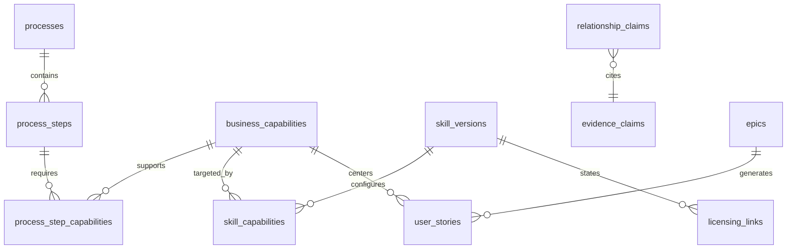

# Unified AI Capability Registry — read-only slice 0.1.0

Discovery layer for Solution Intelligence. It does not install skills, copy pricing records, or call a business action.

## What this slice answers

"For account preparation in the B2B telecom pilot, which Copilotforce or Claudeforce agents and skills, actions, licenses, and user stories are source-backed?"

Run from the repository root:

```bash
python capability-registry/discover.py
python -m unittest capability-registry/tests/test_discover.py
```

A published delivery skill stays `executable=UNKNOWN` and `entitled=UNKNOWN`. An empty match is a gap, not proof that no product exists.

## Ownership

| Concern | Owner | This slice |
| --- | --- | --- |
| Technical docs | `salesforce-docs` master | Not copied |
| Headless / Claudeforce catalog | `krystiandrozd-alt/headless-toolkit` | Not readable in this run |
| Commercial offers and prices | Pricing Intelligence feature branches | Pointer only, not re-verified |
| Delivery skill text | `forcedotcom/sf-skills` | One skill file read at commit `b09f91fe832e19b1f8c5eddd3bfb418640d997b4` |

Existing synthetic resolver fixtures stay fictional. This registry does not promote them.

## Relationship rule

Every relationship has an ID, source, target, type, applicability, evidence, verification, and observation date. `CANDIDATE` name similarity cannot be stored as `VERIFIED`. `UNKNOWN` price is not free. `UNKNOWN` entitlement is not included.

## Schema

`schema.sql` is the normalized store. The ER view for the populated path:



Action, binding, and metering tables exist and are empty until a source is read.
